# 组件工作机制

> 本文使用 Mermaid v11+ 语法绘制项目各组件的工作机制。  
> 约定：组件节点尽量使用圆角矩形 `([ ... ])`；判断节点使用菱形 `{ ... }`；不同层、不同子流程使用不同颜色，便于区分。  
> 建议在支持 Mermaid 的 Markdown 渲染器（GitHub、GitLab、VS Code Mermaid 插件、Claude Code 等）中查看。

---

## 1. 总体组件架构

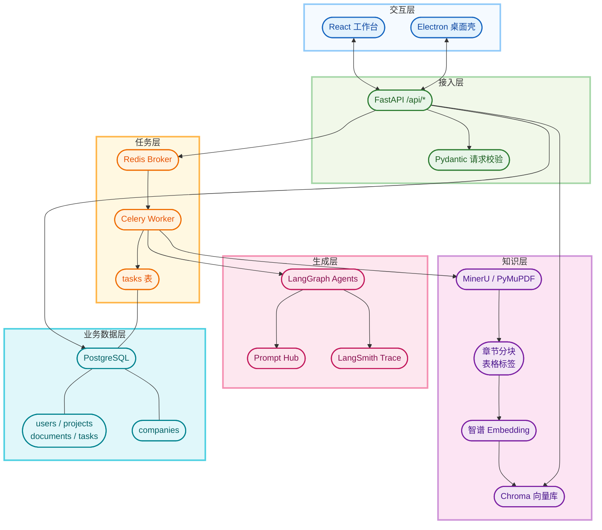

---

## 2. PDF 解析组件

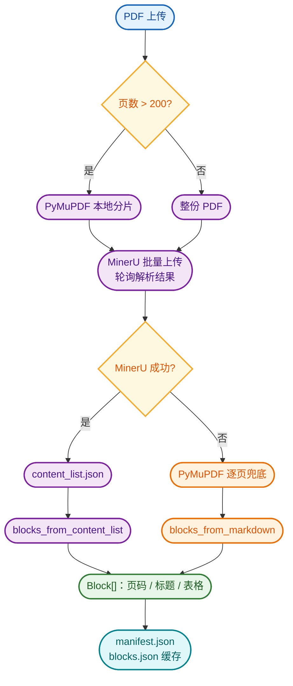

### 解析组件要点

- 超过 200 页时先本地分片，避免超过 MinerU 限制。
- 每个分片带 `page_offset`，把分片内 `page_idx` 还原为全局页码。
- `content_list.json` 是主路径；缺失时用 Markdown 降级。
- 解析结果写 `data/parsed/<doc_id>/`，后续分块、抽取和检索复用缓存。

---

## 3. 内容块与表格分块组件

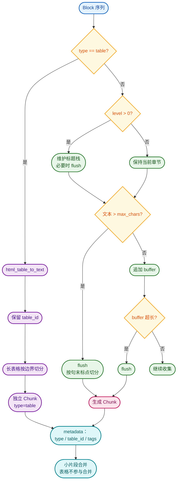

### 分块组件要点

- 表格先 `flush()`，再单独成块，避免和正文合并后丢失 `table_id`。
- 普通文本按标题层级和 `max_chars` 控制。
- 超长文本优先在句末标点处切分，并保留 `overlap` 重叠。
- 小表格不参与 `_merge_small`；普通小片段可合并到前一个普通片段。

---

## 4. 向量化与 Chroma 存储组件

```mermaid
flowchart LR
    A(["Chunk[]"]) --> B(["每批 32 条"])
    B --> C(["智谱 embedding-3"])
    C --> D{"维度报错?"}
    D -->|"是"| D1(["降级模型默认维度"])
    D -->|"否"| E(["1024 维文档向量"])
    D1 --> E
    E --> F(["Chroma PersistentClient"])
    F --> G(["bid_documents<br/>cosine 距离"])
    G --> H(["documents + metadatas<br/>+ embeddings"])
    H --> I(["检索时读取<br/>all_chunks"])

    classDef input fill:#E3F2FD,stroke:#1565C0,color:#0D47A1,stroke-width:2px;
    classDef embed fill:#F3E5F5,stroke:#7B1FA2,color:#4A148C,stroke-width:2px;
    classDef decision fill:#FFF8E1,stroke:#F9A825,color:#E65100,stroke-width:2px;
    classDef vector fill:#E8F5E9,stroke:#2E7D32,color:#1B5E20,stroke-width:2px;
    classDef store fill:#E0F7FA,stroke:#00838F,color:#006064,stroke-width:2px;
    class A input;
    class B,C embed;
    class D decision;
    class D1,E vector;
    class F,G,H store;
    class I input;
```

### 存储组件要点

- 先按 `doc_id` 删除旧片段，再批量 upsert，重复 ingest 幂等。
- 文档向量默认 1024 维。
- 检索查询使用 768 维前缀向量；768 维是 1024 维向量的前缀，可降低冷启动负担。
- 旧 collection 可通过 `zhibiao reindex-metadata` 补齐 `type`、`table_id`、`tags`。

---

## 5. 混合检索组件

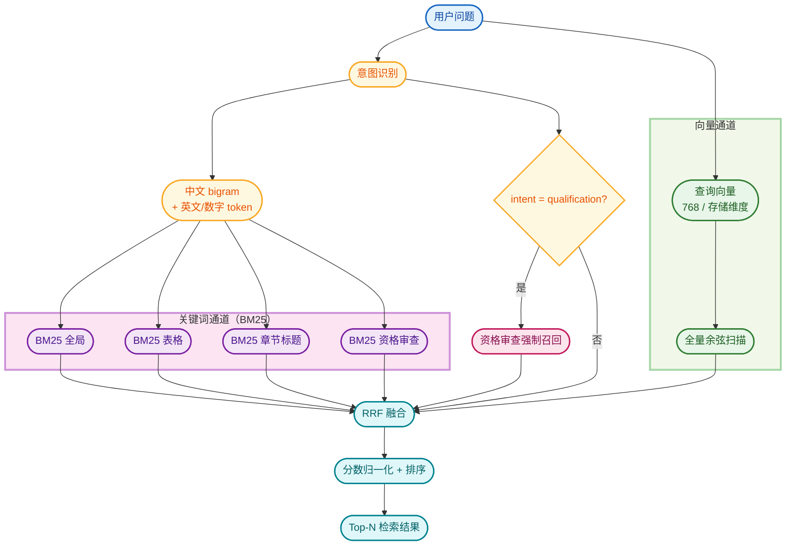

### 检索组件要点

- 关键词优先：表格和章节标题有独立 BM25 通道。
- 语义补充：向量余弦扫描补充同义表达和上下文。
- `qualification` 意图强制召回带“资格审查”标签的块。
- RRF 融合：不同通道按排名贡献分数，避免单一分数尺度不可比。

---

## 6. 意图识别与权重组件

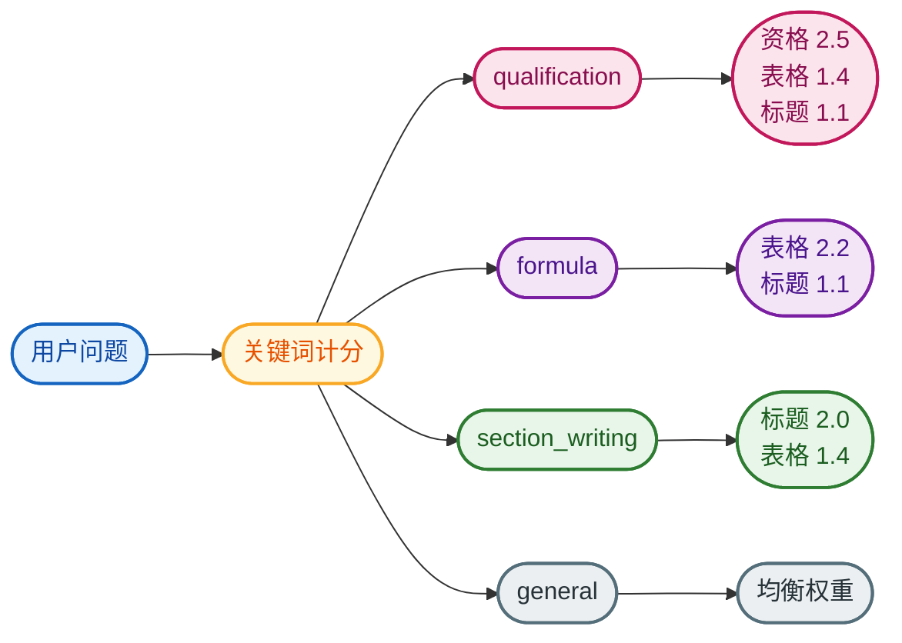

### 意图组件要点

- 规则计分，解释成本低、结果稳定。
- 同分优先级：资格审查 > 计算公式 > 章节写法。
- 权重直接决定表格/标题/资格通道在 RRF 中的贡献。

---

## 7. 结构化抽取组件

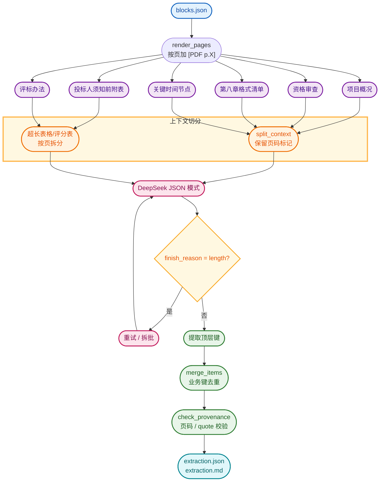

### 抽取组件要点

- 六类信息独立抽取，避免单次上下文过长。
- 每个分片保留最近页码标记。
- 合并时以业务键去重，保留更完整的条目。
- 溯源核对检查页码存在性和 quote 原文子串。
- 当前部分页码范围是样本招标文件特化参数。

---

## 8. 多 Agent 标书生成组件

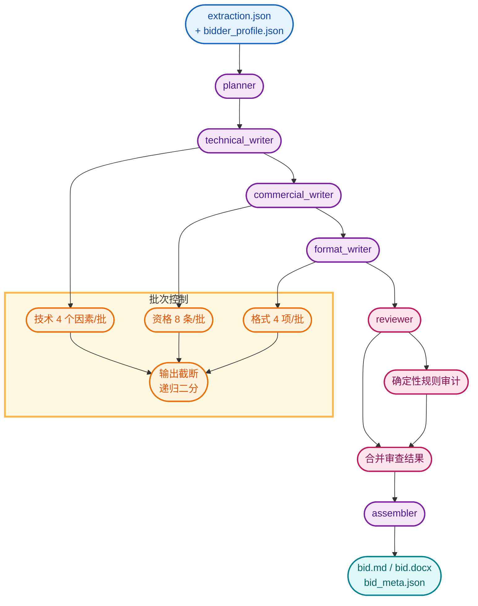

### 多 Agent 组件要点

- 图结构：`planner → technical_writer → commercial_writer → format_writer → reviewer → assembler`。
- 每个 writer 只生成当前批次，降低单次输出截断风险。
- 截断时递归二分，直到单条仍失败才抛出。
- Reviewer 只看标题、评分因素、缺失字段和占位符数量，不重复阅读完整草稿。
- 规则审计与 LLM 审查合并后去重。
- 装配阶段统一重排标题、刷新占位符数量、生成 docx。

---

## 9. API / Celery 任务运行机制

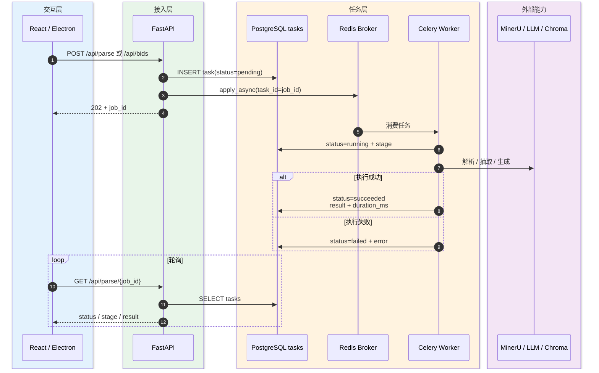

### 任务组件要点

- 任务状态：`pending → running → succeeded / failed`。
- `tasks` 表记录类型、阶段、重试次数、开始/结束时间、耗时、结果和错误。
- API 轮询只读 PostgreSQL，不再依赖 Redis 任务登记表或 Celery `AsyncResult`。
- Celery 状态写入失败只告警，不影响解析/生成主流程。

---

## 10. 业务数据模型组件

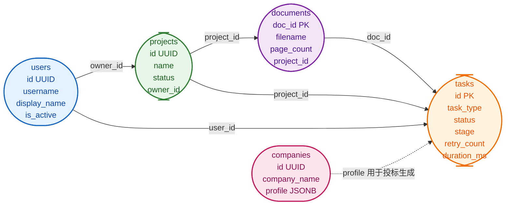

### 数据模型组件要点

- `documents` 以原有 `doc_id` 为主键，便于沿用磁盘缓存命名。
- `tasks` 通过 `doc_id`、`project_id`、`user_id` 关联业务对象。
- `companies.profile` 使用 JSONB，结构与 `bidder_profile.json` 一致。
- 任务状态和文档库查询都从 PostgreSQL 读取，不再扫描磁盘目录。

---

## 11. LangSmith 与 Prompt Hub 组件

```mermaid
flowchart LR
    G(["LangGraph 节点"]) --> T(["@traceable"])
    O(["DeepSeek / OpenAI 调用"]) --> W(["wrap_openai"])
    T --> L(["LangSmith Trace"])
    W --> L

    P(["PromptHub"]) --> PU{"pull_prompt 成功?"}
    PU -->|"是"| H(["Hub 最新模板"])
    PU -->|"否"| F(["本地模板 fallback"])

    CLI(["prompts push"]) --> C(["push_prompt<br/>生成 commit"])

    classDef graph fill:#E3F2FD,stroke:#1565C0,color:#0D47A1,stroke-width:2px;
    classDef trace fill:#F3E5F5,stroke:#7B1FA2,color:#4A148C,stroke-width:2px;
    classDef decision fill:#FFF8E1,stroke:#F9A825,color:#E65100,stroke-width:2px;
    classDef hub fill:#E8F5E9,stroke:#2E7D32,color:#1B5E20,stroke-width:2px;
    classDef local fill:#FFF3E0,stroke:#EF6C00,color:#E65100,stroke-width:2px;
    classDef cli fill:#FCE4EC,stroke:#C2185B,color:#880E4F,stroke-width:2px;
    class G,O graph;
    class T,W,L trace;
    class PU decision;
    class P,H hub;
    class F local;
    class CLI,C cli;
```

### 追踪与 Prompt 组件要点

- LangGraph 节点自动上报；OpenAI/DeepSeek 客户端通过 `wrap_openai` 上报 LLM 调用。
- 每次生成任务按名称拉取 Hub 最新提示词。
- Hub 拉取失败自动回退本地模板，不阻塞生成。
- `prompts push` 将本地模板上传为新的 Prompt commit。

---

## 12. MCP 数据库访问组件

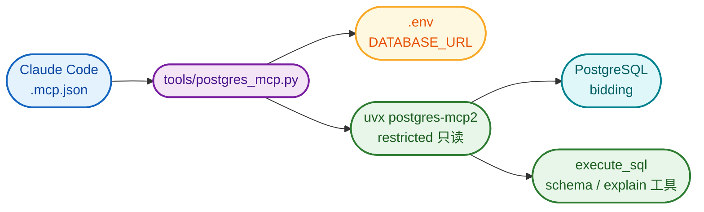

### MCP 组件要点

- `.mcp.json` 只保存命令，不保存数据库密码。
- 启动脚本从 `.env` 读取 `DATABASE_URL`，转换为标准 PostgreSQL URL。
- `postgres-mcp2 --access-mode=restricted` 提供只读查询和 schema 查看。
- 写入操作仍通过 FastAPI 的 `/api/companies` 等业务接口完成。

---

## 13. 前端四步工作台组件

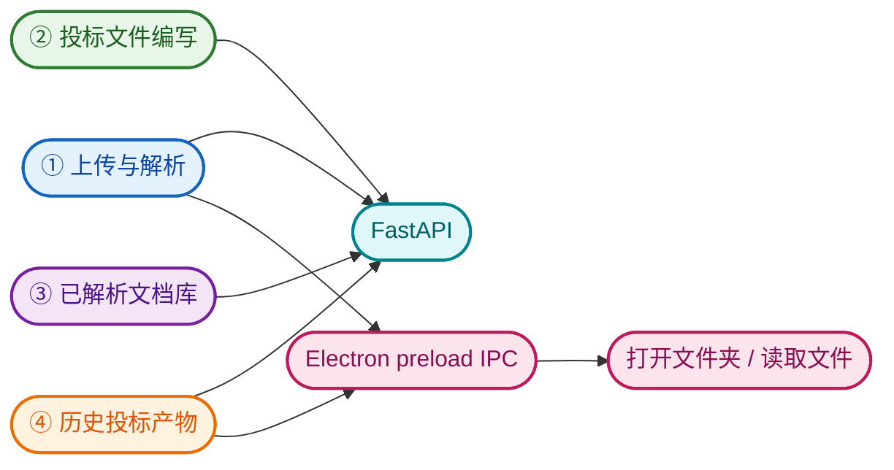

### 前端组件要点

- 左侧步骤导航 + 右侧工作区。
- 上传解析、投标编写、文档库、历史产物四个步骤共用同一个 FastAPI。
- Electron 通过 preload IPC 暴露打开文件夹、读取文件能力，限制在项目目录内。

---

## 14. Alembic 迁移组件

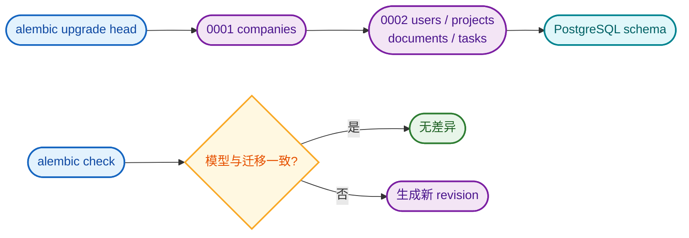

### 迁移组件要点

- 新环境先执行 `uv run alembic upgrade head`。
- 当前 `bidding` 库已将 `companies` 作为 `0001` 基线，再升级到 `0002`。
- `alembic check` 用于发现模型与迁移脚本的差异。

---

## 15. 组件职责速查

| 组件 | 主要职责 | 关键代码 |
|---|---|---|
| React / Electron | 四步工作台、表单、预览、打开文件夹 | `frontend/src/` |
| FastAPI | 上传、检索、任务、公司、文档、历史接口 | `api/routes.py`、`api/schemas.py` |
| Celery / Redis | 异步解析、投标生成、任务消费 | `src/zhibiao/tasks.py` |
| PostgreSQL | 任务状态、文档库、项目、用户、公司 | `src/zhibiao/db_models.py`、`company.py` |
| MinerU / PyMuPDF | PDF 解析、分片、兜底 | `src/zhibiao/mineru.py`、`fallback.py` |
| content_list / chunker | 内容块标准化、表格处理、章节分块 | `content_list.py`、`chunker.py` |
| Embedder / Chroma | 智谱嵌入、向量存储、元数据 | `embedder.py`、`store.py` |
| Retrieval | 意图识别、BM25、向量、RRF、强制召回 | `retrieval.py`、`metadata.py` |
| Extractor | 六类结构化抽取、合并去重、溯源 | `extractor.py` |
| LangGraph | 多 Agent 标书生成、审查、装配 | `bid_writer.py` |
| Prompt Hub / LangSmith | 提示词版本化、Trace 上报 | `prompts.py`、`llm.py` |
| Alembic | 数据库 schema 版本管理 | `alembic/` |
| MCP | 只读数据库访问 | `.mcp.json`、`tools/postgres_mcp.py` |

---

## 16. 阅读顺序建议

1. 先看 **总体组件架构**，理解 UI、API、任务、知识、生成、数据六层。
2. 再看 **PDF 解析 → 内容块/表格分块 → 向量化存储**，理解知识库如何建立。
3. 重点看 **混合检索** 和 **意图识别**，理解 BM25、表格/标题通道、资格审查强制召回。
4. 然后看 **结构化抽取** 与 **多 Agent 标书生成**，理解抽取和写作链路。
5. 最后看 **API/Celery 任务**、**数据模型**、**LangSmith**、**MCP** 和 **Alembic**，理解运行与运维。
